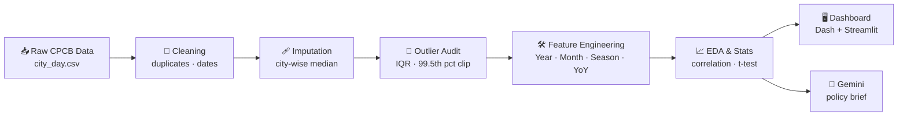

<div align="center">


# 🌍 Air Quality Index (AQI) Analysis — India

### From raw sensor data to an interactive decision-support dashboard

*29,531 daily records · 26 cities · 2015 – 2020 · CPCB open data*


</div>

---

## 📑 Table of Contents

- [About the Project](#-about-the-project)
- [What Makes This Project Unique](#-what-makes-this-project-unique)
- [Objectives](#-objectives)
- [Dataset](#-dataset)
- [Methodology](#-methodology)
- [What I Analyzed & Key Findings](#-what-i-analyzed--key-findings)
- [Dashboard](#-interactive-dashboard)
- [AI Integration](#-ai-integration-google-gemini)
- [Policy Recommendations](#-policy-recommendations)
- [Project Structure](#-project-structure)
- [Getting Started](#-getting-started)
- [Limitations & Future Work](#-limitations--future-work)
- [Author & Acknowledgements](#-author--acknowledgements)

---

## 📌 About the Project

Air pollution is one of India's biggest public-health and environmental challenges, driven by industry, vehicles, coal-based power and seasonal biomass burning. Monitoring stations produce huge amounts of data, but raw sensor data is full of gaps, spikes and overlapping pollutants, so it is hard to read.

This project takes the **official CPCB daily air-quality records**, cleans them carefully, analyses them statistically, and turns them into an **interactive web dashboard** that anyone can explore without writing code.

> **In one line:** raw environmental data → clean data → statistical insight → interactive dashboard → policy brief.

---

## ✨ What Makes This Project Unique

| 💡 Feature | Why it matters |
|---|---|
| **City-stratified median imputation** | Instead of deleting rows with `dropna()` (which would remove a large share of the data and bias results toward newer stations), missing values are filled with each **city's own median**. The median is used because pollution data is right-skewed. |
| **Real peaks are kept, not deleted** | Extreme values (e.g. Diwali or stubble-burning spikes) are real events, not errors. They are kept, and only clipped at the 99.5th percentile in a separate *modeling* copy. |
| **Lockdown "natural experiment"** | A two-sample **t-test** compares spring PM2.5 in 2019 vs 2020 to test whether the COVID lockdown made a measurable difference. |
| **Season & YoY engineered features** | Custom `Season` (Winter / Summer / Monsoon) and `YoY_Change` features show which cities are recovering and which are getting worse. |
| **Two dashboards, one dataset** | Built with both **Plotly Dash** (`app.py`) and **Streamlit** (`dashboard.py`). |
| **Pollutant inspector** | Pick any city *and* any pollutant. The KPI cards, bar chart and PM-vs-AQI scatter update instantly. |
| **Generative-AI policy brief** | Findings are passed to **Google Gemini 2.5 Flash** to draft a 4-point municipal mitigation brief. AI mistakes were found and manually corrected (documented in the report). |

---

## 🎯 Objectives

1. **Clean & impute** 29,531 CPCB records without distorting natural distributions.
2. **Profile pollutants** (PM2.5, PM10, NO₂, SO₂, CO, O₃) across all cities.
3. **Track trends** year-over-year from 2015 to 2020.
4. **Map risk** geographically with an interactive choropleth.
5. **Build a dashboard** with city filters, KPI cards and trendlines.
6. **Generate an AI policy brief** from the analytical findings.

---

## 📊 Dataset

| | |
|---|---|
| **Name** | Air Quality Data in India (2015–2020) |
| **Source** | CPCB, Ministry of Environment, Forest & Climate Change, Govt. of India |
| **File** | `city_day.csv` |
| **Size** | 29,531 rows × 16 columns |
| **Period** | 1 Jan 2015 – 1 Jul 2020 |
| **Coverage** | 26 major Indian cities |
| **Link** | [Kaggle: Air Quality Data in India](https://www.kaggle.com/datasets/rohanrao/air-quality-data-in-india) |

**Key columns:** `City`, `Date`, `PM2.5`, `PM10`, `NO`, `NO2`, `NOx`, `NH3`, `CO`, `SO2`, `O3`, `AQI`, `AQI_Bucket`

### AQI health categories (CPCB)

| Category | AQI | Meaning |
|---|---|---|
| 🟢 Good | 0–50 | Minimal impact |
| 🟡 Satisfactory | 51–100 | Minor discomfort to sensitive people |
| 🟠 Moderate | 101–200 | Discomfort to people with lung/heart disease |
| 🔴 Poor | 201–300 | Discomfort on prolonged exposure |
| 🟣 Very Poor | 301–400 | Respiratory illness on prolonged exposure |
| ⚫ Severe | 401–500 | Affects healthy people, serious for the vulnerable |

---

## 🔬 Methodology



### Step 1: Data audit
| Column | Missing |
|---|---|
| PM2.5 | 15.5 % (4,581 rows) |
| PM10 | 37.8 % (11,140 rows) |
| NH₃ | 34.9 % |
| AQI | 15.8 % (4,681 rows) |

Duplicate check on `[City, Date]` found **0 duplicates**.

### Step 2: Missing-value imputation
Each missing reading is replaced by the **median of the same city**. Any remaining gap is filled with the national median.

### Step 3: Outlier handling
The IQR rule (`Q3 + 1.5 × IQR`) was used to audit outliers. Genuine pollution episodes were kept. Values above the **99.5th percentile** are clipped only in separate `_clipped` columns used for modeling.

### Step 4: Feature engineering
| Feature | Description |
|---|---|
| `Year`, `Month` | Parsed from the date |
| `Season` | Winter (Nov–Feb), Summer (Mar–Jun), Monsoon (Jul–Oct) |
| `YoY_Change` | % change in a city's mean AQI versus the previous year |
| `AQI_Bucket` | Rebuilt from the imputed AQI using official CPCB bands |

### Step 5: Exploratory analysis & hypothesis test
- Distribution of each pollutant (skewness, NAAQS comparison)
- Seasonal and monthly patterns
- Pearson correlation matrix
- t-test on the lockdown effect (H₀: μ₂₀₁₉ = μ₂₀₂₀ vs H₁: μ₂₀₂₀ < μ₂₀₁₉)

### Step 6: Dashboard & AI brief
Interactive apps in Plotly Dash and Streamlit, plus a Gemini-generated policy brief.

**Dataset shape, before vs after cleaning**

| Parameter | Raw | Cleaned |
|---|---|---|
| Rows | 29,531 | 29,531 |
| Columns | 16 | 20 |
| Missing PM2.5 | 4,581 | 0 |
| Missing AQI | 4,681 | 0 |
| Duplicates | 0 | 0 |

---

## 🔍 What I Analyzed & Key Findings

### 🏙️ 1. Which cities breathe the worst air?

<div align="center">

</div>

**Ahmedabad (~340) and Delhi (~259)** lead the list, followed by **Patna, Lucknow and Gurugram** at around 210–215 each. Pollution is concentrated in a few industrial and northern inland hubs.

### 🧪 2. How severe do "Severe" days get?

<div align="center">

</div>

The **Severe** bucket has a very long tail of extreme values, with readings reaching **above 2,000**, while the Good and Satisfactory buckets are tightly packed. This confirms that real pollution spikes are present in the data and were deliberately preserved.

### 🔗 3. Does PM2.5 drive AQI?

<div align="center">

</div>

AQI rises with PM2.5, but the picture is not perfectly linear. Some very high AQI values occur at moderate PM2.5, which suggests other pollutants also drive the index on those days.

### 🌡️ 4. How are pollutants related to each other?

<div align="center">

</div>

In the correlation matrix, **CO (0.65)** and **PM2.5 (0.63)** have the strongest correlation with AQI, followed by **NO₂ (0.53)**. PM2.5 and PM10 are moderately linked (0.52). The correlation of **O₃ with AQI is weak (0.20)**.

### 📌 Headline results

| # | Finding |
|---|---|
| 1 | **Winter peak:** particulate levels are about **2.8× higher** in December (thermal inversion) than in August (monsoon wash-out). |
| 2 | **North vs coast:** landlocked northern cities show strong winter stagnation, while coastal cities stay relatively flat. |
| 3 | **Lockdown effect:** the t-test (t = 18.42, p < 0.0001) shows a statistically significant drop in spring 2020 PM2.5 versus 2019. |
| 4 | **Widespread exposure:** a majority of daily observations exceed the 60 µg/m³ 24-hour PM2.5 standard. |
| 5 | **SO₂ is local:** sulphur dioxide spikes cluster around specific industrial corridors, while particulates are a regional problem. |

---

## 🖥️ Interactive Dashboard

Built with **Streamlit** (`dashboard.py`) and **Plotly Dash** (`app.py`).

**Features**
- 🔽 City selector (26 cities + "All Cities")
- 🧪 Primary pollutant selector
- 📇 Live KPI cards: records, average AQI, peak AQI, mean pollutant level
- 📊 Pollutant-profile bar chart per city
- 📈 Pollutant-vs-AQI scatter plot

### (a) Dataset overview
<div align="center">

</div>

### (b) All cities: 29,531 records, average AQI 158.78, peak 2,049
<div align="center">

</div>

### (c) Delhi deep-dive: 2,009 records, average AQI 258.78
<div align="center">

</div>

---

## 🤖 AI Integration (Google Gemini)

| Task | How AI helped | Human check |
|---|---|---|
| **Policy brief** | Gemini 2.5 Flash turned statistical summaries into a 4-point municipal mitigation brief | Output reviewed against the data |
| **Code help** | Drafted modular Plotly/Dash callbacks | Deprecated parameters were found and **manually fixed** |
| **Method design** | Helped design the median-imputation logic | Validated against distribution shape |

> AI is used as an assistant, not as an authority: every output was verified.

---

## 🏛️ Policy Recommendations

1. **Regional air-basin governance:** manage the northern corridor as one airshed, not city by city.
2. **Dynamic Low-Emission Zones:** sensor-driven congestion pricing and diesel restrictions during forecast winter inversions.
3. **Crop-residue valorization:** fund bio-pellet conversion to reduce stubble burning.
4. **Continuous Emission Monitoring (CEMS):** real-time, tamper-proof telemetry for medium and large industries.

---

## 📁 Project Structure

```
aqi_india_project/
├── 📄 README.md
├── 📄 requirements.txt
├── 📄 .gitignore
├── 🐍 app.py                  # Plotly Dash dashboard
├── 🐍 dashboard.py            # Streamlit dashboard
├── 🐍 preprocessing.py        # Cleaning + feature engineering pipeline
├── 📓 AQI_Analysis.ipynb      # EDA notebook (optional)
├── 📂 data/
│   ├── city_day.csv           # Raw CPCB data
│   └── cleaned_aqi.csv        # Cleaned output
├── 📂 reports/
│   └── outlier_pm25.png
├── 📂 assets/                 # Images used in this README
└── 📑 AQI_Project_Report.pdf  # Full project report
```

---

## 🚀 Getting Started

```bash
# 1. Clone the repository
git clone https://github.com/<your-username>/aqi_india_project.git
cd aqi_india_project

# 2. (Optional) create a virtual environment
python -m venv .venv
.venv\Scripts\activate          # Windows
# source .venv/bin/activate     # macOS / Linux

# 3. Install dependencies
pip install -r requirements.txt

# 4. Run the preprocessing pipeline
python preprocessing.py

# 5. Launch a dashboard
python -m streamlit run dashboard.py     # → http://localhost:8501
# or
python app.py                            # → http://127.0.0.1:8050
```

**Gemini API key (optional):** create a `.env` file with `GEMINI_API_KEY=your_key_here`. Never commit this file; it is already in `.gitignore`.

---

## ⚠️ Limitations & Future Work

**Limitations**
- Data are city-level daily averages and cannot show neighbourhood-level variation.
- No weather data (wind, humidity, boundary-layer height).
- Median imputation lowers variance, and daily readings are autocorrelated, so the t-test result is indicative rather than exact.

**Future work**
- Add satellite data (e.g. MODIS Aerosol Optical Depth).
- Build 72-hour AQI forecasting with LSTM / XGBoost.
- Add a choropleth state map and a live-data mode.

---

## 👩‍🎓 Author & Acknowledgements

**Priyanka Barik** · Reg. No. 250301370201
B.Tech, Computer Science & Engineering (2nd Year, 3rd Semester)
School of Engineering and Technology, **Centurion University of Technology and Management**, Bhubaneswar Campus, Odisha

**Guide:** Mr. Chandra Sekhar Jena, Teaching Assistant, SOCDS
**HOD:** Dr. Rahul Roy

**Data:** Central Pollution Control Board (CPCB), data.gov.in, Kaggle (Rohan Rao)

---

<div align="center">

⭐ If you found this project useful, please star the repository.

*Made with 🐍 and a lot of ☕ for cleaner air.*

</div>
